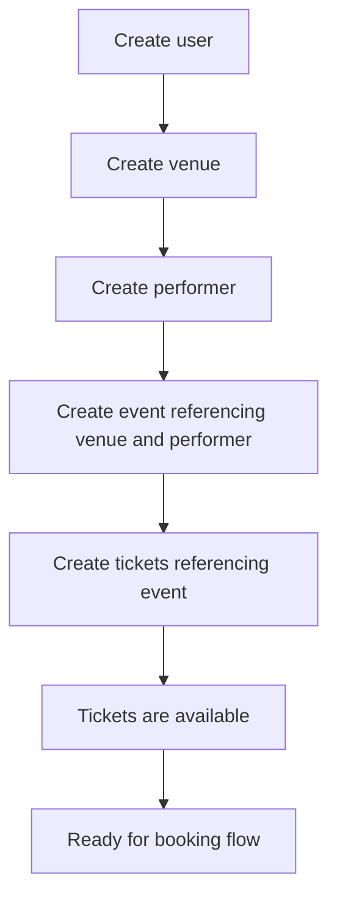
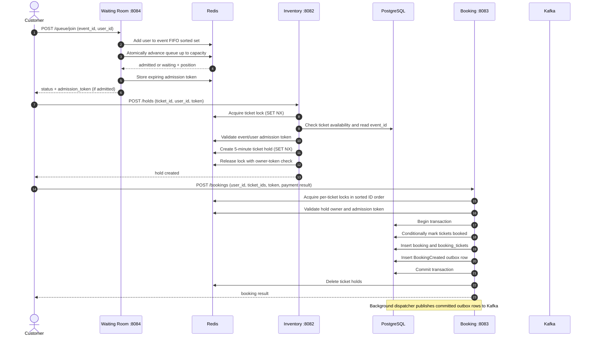
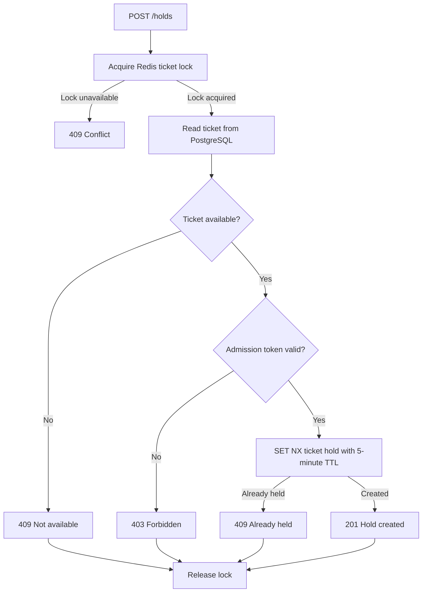
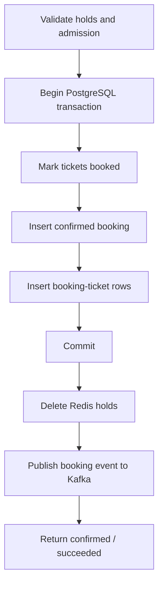
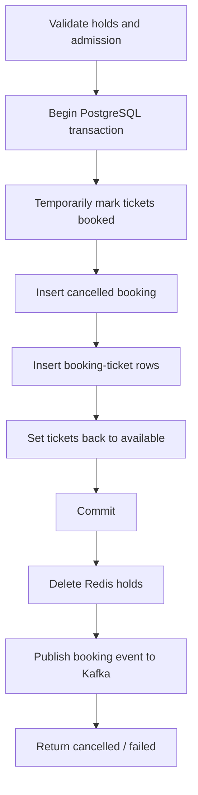
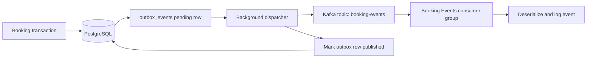

# QuickTicket — System and Request Flows

This document explains how a request moves through the QuickTicket backend. It is intended as a compact companion to the [API testing guide](../README.md).

## 1. Services and responsibilities

| Service | Port | Owns |
|---|---:|---|
| Catalog | 8081 | CRUD for users, venues, performers, events |
| Waiting Room | 8084 | HTTP API, FIFO queue service, admission-token service; Redis is the shared state store |
| Inventory | 8082 | Ticket CRUD and temporary ticket holds |
| Booking | 8083 | Booking transaction, mock payment result, transactional outbox dispatcher |
| Booking Events | worker | Consumes booking events from Kafka and logs them |

Shared infrastructure:

- **PostgreSQL** stores catalogue data, ticket state, bookings, and booking-ticket relationships.
- **Redis** stores waiting-room state, admission tokens, temporary holds, and short-lived seat-operation locks.
- **Kafka** transports booking events from Booking to the Booking Events worker.

## 2. Initial data flow

Before a customer can book, the catalogue and inventory must exist.



All catalogue CRUD requests go to Catalog (`8081`). Ticket CRUD goes to Inventory (`8082`). Both services persist data in PostgreSQL.

## 3. Customer booking flow

The happy path is: join the queue, get admitted, hold a seat, then book it.



### Step-by-step

1. The customer joins the event queue with `POST /queue/join`.
2. Waiting Room adds the user to an event-specific Redis sorted set. The score is the enqueue timestamp; `NX` prevents duplicate joins from changing the original queue position.
3. The queue package runs a Redis Lua script that atomically expires old admissions and admits the oldest waiting users until the configured capacity is reached.
4. The admission package creates or retrieves an admission token. The token is stored in Redis with a TTL and must be sent to Inventory and Booking.
5. Inventory acquires a short-lived Redis lock for the ticket, checks PostgreSQL availability, validates the admission token, and creates a five-minute Redis hold for that user.
6. Booking acquires locks for all requested tickets in sorted ID order, checks that each hold belongs to the user, and validates the admission token for each ticket's event.
7. Booking starts a PostgreSQL transaction. It conditionally changes each ticket from `available` to `booked`, calculates the total, inserts the booking and its ticket relationships, and commits.
8. Booking inserts a `BookingCreated` event into `outbox_events` before committing. The booking and event therefore either both commit or neither commits. After commit, Booking removes the Redis holds and returns the booking result. A background dispatcher publishes pending outbox rows to Kafka.

## 4. Waiting-room flow

Redis keys are scoped by event:

| Key | Redis type | Purpose |
|---|---|---|
| `event:{eventID}:waiting` | Sorted set | FIFO users waiting for the event |
| `event:{eventID}:admitted` | Sorted set | Admitted users; score is admission expiry time |
| `event:{eventID}:token:{userID}` | String | Admission token with TTL |

Endpoints:

- `POST /queue/join` — add the user if not already queued and attempt admission.
- `POST /queue/status` — attempt to advance the queue and return admission or current position.

Example join request:

```http
POST http://localhost:8084/queue/join
Content-Type: application/json

{"event_id": 1, "user_id": 1}
```

Waiting response:

```json
{"event_id":1,"user_id":1,"status":"waiting","position":1}
```

Admitted response:

```json
{
  "event_id": 1,
  "user_id": 1,
  "status": "admitted",
  "admission_token": "TOKEN",
  "admission_expires_in_seconds": 600
}
```

The waiting-room code is separated into `internal/httpapi` (HTTP parsing and responses), `internal/queue` (FIFO operations and Lua script), and `internal/admission` (token creation and TTL). `main.go` only wires dependencies and starts the server.

**Why Lua instead of separate Redis commands?**

The queue transition touches several keys and depends on the result of earlier commands. If the application performed each step separately, two concurrent polls could both observe a free slot and both admit a user. Redis executes a Lua script atomically, so no other Redis command can interleave between expiry cleanup, capacity checks, FIFO promotion, and position lookup.

Lua also reduces network round trips and keeps the state transition close to the Redis data it changes. It does not make Redis, PostgreSQL, and Kafka one distributed transaction; it only makes this group of Redis operations atomic.

The default Compose configuration admits up to two users concurrently and gives admission tokens a 600-second TTL. These are demo settings, not recommended production values.

## 5. Seat hold and concurrency flow



Relevant Redis keys:

- `ticket:lock:{ticketID}` — short-lived mutual-exclusion lock for a seat operation.
- `ticket:hold:{ticketID}` — user ID holding the ticket, expiring after five minutes.

The lock is acquired with `SET NX` and released by a Lua script that deletes it only if the stored owner token matches. This prevents one request from deleting another request's lock.

A Redis hold is temporary coordination state, not the final booking record. PostgreSQL's conditional ticket update and transaction are the final inventory consistency guard.

## 6. Booking and mock payment outcomes

The Booking endpoint accepts `mock_payment_result` as `success` or `failure`. If omitted, it defaults to `success`.

### Payment succeeds



### Payment fails



The failed booking remains in booking history, while its tickets become available again. The booking-ticket relationship is retained for audit/demo purposes.

## 7. Kafka event flow



The booking transaction writes both the booking state and its outbox event to PostgreSQL. The dispatcher polls pending rows, locks a batch using `FOR UPDATE SKIP LOCKED`, publishes each event, and marks it published after Kafka acknowledges it.

The event currently contains:

- `event_id` (stable deduplication key)
- `event_type` (`BookingCreated`)
- `booking_id`
- `user_id`
- `ticket_ids`
- `total`
- `status`
- `payment_status`

The Booking Events worker only logs consumed messages. It is a placeholder for future consumers such as email, notifications, analytics, or ticket delivery.

**Delivery semantics:** the outbox closes the database-commit/publish gap, but publication is at-least-once. If the process crashes after Kafka acknowledges an event but before PostgreSQL records `published_at`, the event can be sent again. The stable `event_id` lets consumers deduplicate. Keep consumers idempotent. This demo dispatcher holds row locks while publishing a small batch; a high-throughput production system may use shorter claim leases and separate publish/ack phases.

## 8. Important boundaries and current limitations

- Catalog and Inventory own separate HTTP APIs, but they share the same PostgreSQL database in this learning project.
- Waiting Room admission is enforced by token checks in both Inventory and Booking.
- The admission slot expires by TTL; the current implementation does not release it immediately when a booking completes.
- Ticket holds expire after five minutes. A customer must complete booking before the hold expires.
- Redis locks are short-lived leases, not a replacement for database transactions or conditional updates.
- The payment integration is mocked. No external payment provider is called.
- Kafka consumer processing currently logs events; it does not update another service or send notifications.
- The outbox dispatcher is part of the Booking process and polls once per second. Multiple replicas can share work using PostgreSQL `SKIP LOCKED`, but duplicate publication remains possible around the Kafka-ack/database-commit boundary.
- There is no authentication, API gateway, frontend, or production deployment configuration.

## 9. Suggested demo sequence

For a quick end-to-end demonstration:

1. Start dependencies and services with `docker compose up --build`.
2. Run the SQL seed from `db/seeds/001_bengaluru_events_2026_27.sql`.
3. Create a test user through Catalog, or use an existing seeded/test user ID.
4. Pick an event and one available ticket from `GET /tickets`.
5. Join the waiting room and copy the admission token.
6. Create a hold for the ticket using that token.
7. Create a booking with `mock_payment_result: "success"`.
8. Inspect `GET /bookings`, ticket status, and the Booking Events worker logs.
9. Repeat with another available ticket and `mock_payment_result: "failure"` to demonstrate that the ticket returns to inventory.

For exact request bodies and curl commands, use the [API testing guide](../README.md).
