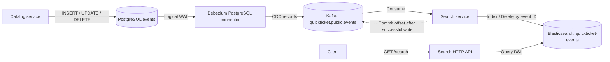

# Elasticsearch CDC Flow

This document explains how QuickTicket keeps its Elasticsearch event-search index synchronized with PostgreSQL using Debezium and Kafka.

## 1. Why CDC is used

PostgreSQL is the system of record for event data. The Catalog service creates, updates, and deletes events in PostgreSQL. Search traffic is served from Elasticsearch so that full-text queries and filters do not compete with transactional Catalog or booking workloads.

The Search index is a derived, rebuildable read model. It is **eventually consistent**: a database commit and the corresponding search-index update are separate asynchronous operations.

## 2. Component responsibilities

| Component | Responsibility |
| --- | --- |
| Catalog | Writes event records to PostgreSQL. |
| PostgreSQL | Stores authoritative event data and exposes row changes through its logical write-ahead log (WAL). |
| Debezium PostgreSQL connector | Takes the initial snapshot and streams committed row-level changes from PostgreSQL. |
| Kafka | Buffers and distributes CDC records in topic `quickticket.public.events`. |
| Search consumer | Reads Debezium records, transforms event rows into Elasticsearch documents, and commits Kafka offsets after successful indexing. |
| Elasticsearch | Stores the searchable projection in index `quickticket-events`. |
| Search HTTP API | Accepts query/filter requests and returns Elasticsearch search results. |

## 3. End-to-end architecture



## 4. Event lifecycle

### Initial snapshot

When the connector is first started with `snapshot.mode=initial`, Debezium reads the existing rows from the configured `public.events` table and emits snapshot records to Kafka. The Search consumer indexes those rows, so the search index can be populated even when events existed before CDC was enabled.

### Create or update

1. A client calls the Catalog API.
2. Catalog commits the event change in PostgreSQL.
3. PostgreSQL records the committed change in its logical WAL.
4. Debezium reads the WAL change and publishes a CDC record to Kafka.
5. The Search consumer deserializes the Debezium envelope.
6. For an insert or update, it reads the `after` row and sends an Elasticsearch `PUT` using the event ID as the document ID.
7. After Elasticsearch acknowledges the write, the consumer commits the Kafka message offset.

Using the event ID as the document ID makes replaying the same insert/update safe: the same document is overwritten rather than duplicated.

### Delete

For a delete, Debezium provides the previous row in `before` and the operation code `d`. The Search consumer deletes the Elasticsearch document with that event ID. A not-found response is treated as success, which makes repeated delete processing safe. The Kafka offset is committed after the delete succeeds.

## 5. Debezium record handling

The consumer currently reads the Debezium envelope fields:

| Field | Meaning | Search consumer behavior |
| --- | --- | --- |
| `payload.op` | Operation code (for example, `c`, `u`, `d`, `r`) | Determines whether to index or delete. |
| `payload.before` | Row before the change | Used to obtain the ID for deletes. |
| `payload.after` | Row after the change | Used as the indexed event document for creates, updates, and snapshot reads. |

The consumer handles snapshot/read records and create/update records through `payload.after`. Delete records use `payload.before`. Records without either row (such as metadata/heartbeat records) are acknowledged without changing Elasticsearch.

The connector is configured to publish the events table only. Its topic name follows Debezium's `topic.prefix` and table naming convention: `quickticket.public.events`.

## 6. Delivery guarantees and failure behavior

The pipeline is designed for **at-least-once processing**, not exactly-once delivery across Kafka and Elasticsearch.

- The consumer fetches a Kafka message without automatically committing it.
- It attempts the corresponding Elasticsearch operation.
- If Elasticsearch returns an error, the consumer retries and does not commit the message offset.
- Once indexing or deletion succeeds, the consumer commits the offset.
- If the process crashes after Elasticsearch succeeds but before Kafka offset commit, Kafka can deliver the message again. Stable document IDs make the repeated write/delete idempotent.

A malformed CDC message is currently logged and skipped so it does not block the partition. A production implementation should route malformed or permanently failing records to a dead-letter topic with the original payload, error details, and source coordinates before advancing the offset.

## 7. Search document and query API

The current event document contains:

```json
{
  "id": 123,
  "name": "Example Live Concert",
  "description": "An evening live music event",
  "event_type": "concert",
  "starts_at": "2027-04-18T18:30:00Z",
  "venue_id": 12,
  "performer_id": 34
}
```

The index maps event names and descriptions as full-text fields, event type as a keyword, event dates as dates, and IDs as numeric fields.

Search endpoint:

```http
GET http://localhost:8085/search?q=live&type=concert&venue_id=12&from=2027-01-01T00:00:00Z&to=2027-12-31T23:59:59Z&page=1&size=20
```

Supported parameters:

- `q`: full-text query over event name, description, and event type.
- `type`: exact event-type filter.
- `venue_id`: exact venue ID filter.
- `from`, `to`: event start-time range.
- `page`, `size`: pagination; size is capped at 100.

Search is for discovery only. It must not be used to decide whether a ticket is available or whether a booking can be accepted. Those decisions remain in the transactional Inventory and Booking services.

## 8. Local development and verification

Start the stack:

```bash
docker compose up --build -d
```

Check Search and Debezium:

```bash
curl http://localhost:8085/health
curl http://localhost:8083/connectors/quickticket-postgres/status
```

Create an event through Catalog, then query it through Search after CDC has propagated:

```bash
curl 'http://localhost:8081/events'
curl 'http://localhost:8085/search?q=Example'
```

Useful logs:

```bash
docker compose logs -f debezium search
```

Inspect Kafka topics using the Kafka CLI inside the broker container, or inspect the connector's status endpoint when troubleshooting.

## 9. Operational considerations and current scope

- **PostgreSQL configuration:** logical replication requires `wal_level=logical`. Compose starts PostgreSQL with this setting. Restart PostgreSQL after changing the Compose command; changing the setting on an already-running server is not enough.
- **Existing volumes:** connector offsets and replication-slot state persist. Recreating containers does not necessarily trigger a new snapshot.
- **Rebuilds:** for a controlled rebuild, coordinate a new Elasticsearch index with a deliberate CDC replay/reset strategy. Do not casually delete the index while keeping the consumer group at its latest offsets, or old rows will remain missing.
- **Schema evolution:** changes to the event table or Debezium envelope should be reflected in the consumer and index mappings.
- **Denormalization:** this version indexes only columns from `public.events`. Venue and performer names are not yet included. Add CDC for related tables and maintain a joined projection if searching by those names is required.
- **Security:** Elasticsearch and Kafka Connect are exposed for local development and are not configured with production authentication/TLS.
- **Resilience:** production deployment should add a dead-letter topic, bounded retry/backoff policy, consumer lag monitoring, Elasticsearch bulk indexing, index aliases/versioning, and connector/replication-slot monitoring.

## 10. Key design takeaway

The CDC pipeline decouples search indexing from the Catalog write path. Catalog commits once to PostgreSQL; Debezium and Kafka propagate the committed change asynchronously; Search maintains an Elasticsearch projection and serves read-heavy discovery queries. This keeps PostgreSQL authoritative while allowing the search layer to scale and evolve independently.
